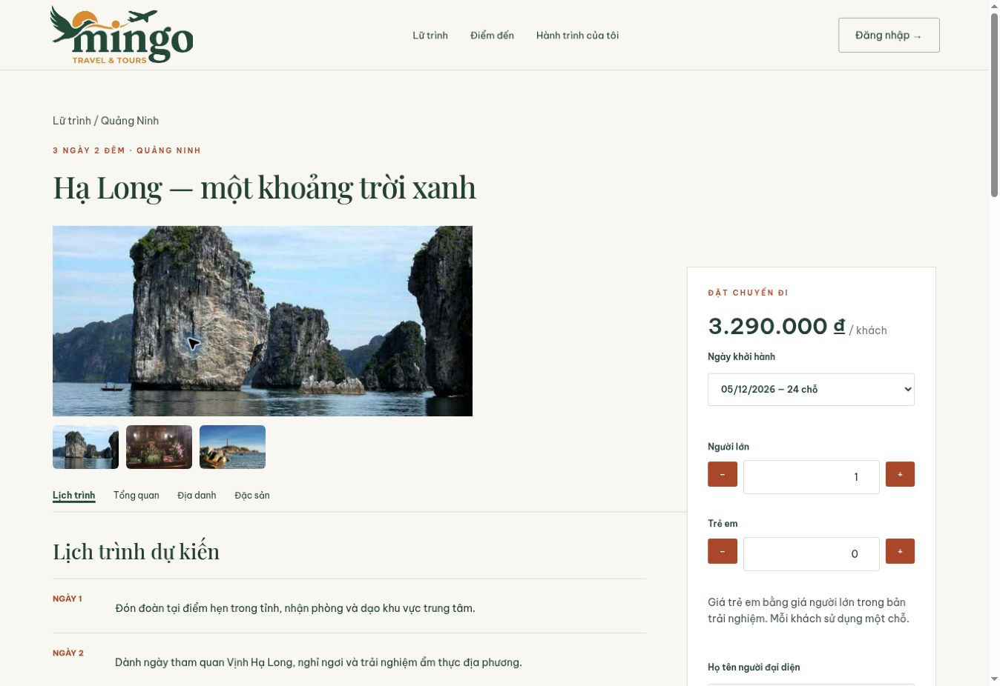

# mingo — Travel & Tours

Website quản lý tour du lịch: quản lý tour, lịch khởi hành và đơn đặt tour, có trang xử lý đơn và báo cáo cho quản trị viên.

**Bản đang chạy:** <https://mingo.doquangminh1807.workers.dev/>


<details>
<summary>Ảnh chi tiết tour Hạ Long</summary>



</details>

Dự án là bài tập lớn cuối kỳ học phần Lập trình hướng đối tượng (MI4090), đề tài Xây dựng Hệ thống Thông tin Quản lý. Phiếu đánh giá của học phần có 2 trục và 5 nhóm tiêu chí; bảng minh chứng nằm ở mục [Tài liệu & minh chứng](#tài-liệu--minh-chứng).

## Mục lục

- [Tính năng](#tính-năng)
- [Công nghệ](#công-nghệ)
- [Cấu trúc thư mục](#cấu-trúc-thư-mục)
- [Kiến trúc tóm tắt](#kiến-trúc-tóm-tắt)
- [Chạy nhanh (demo SQLite)](#chạy-nhanh-demo-sqlite)
- [Phát triển cục bộ (D1 + Wrangler)](#phát-triển-cục-bộ-d1--wrangler)
- [Kiểm thử](#kiểm-thử)
- [Triển khai lên Cloudflare](#triển-khai-lên-cloudflare)
- [Hồ sơ bàn giao](#hồ-sơ-bàn-giao)
- [Tài liệu & minh chứng](#tài-liệu--minh-chứng)
- [Hạn chế](#hạn-chế)
- [Giấy phép và tác giả](#giấy-phép-và-tác-giả)

## Tính năng

- Quản lý tour, lịch khởi hành và đơn đặt tour, lưu trên Cloudflare D1.
- Quản trị viên đăng nhập, xem và xử lý danh sách đơn ở mục **Xử lý đơn**.
- Mục **Báo cáo** để đối chiếu số liệu với dữ liệu nguồn.
- Xác thực quản trị bằng mật khẩu băm kèm salt; phiên đăng nhập ký bằng khóa bí mật riêng.
- Dữ liệu địa danh và đặc sản dùng chung nằm trong `dist/Resource/`, có trình chỉnh sửa riêng (xem [Hạn chế](#hạn-chế)).
- Bản demo tự tạo **126 đơn đặt tour** trên SQLite trong bộ nhớ, chạy không cần Node.js hay Cloudflare.
- **Khách:** Tìm tour theo miền, khoảng giá và thời lượng. Xem giá, lịch trình theo ngày, lịch khởi hành, số chỗ còn lại, địa danh và đặc sản. Đăng nhập để chọn ngày và số khách, đặt tour giữ chỗ, theo dõi đơn trong **Hành trình của tôi** và hủy đơn đang chờ xác nhận, chưa thanh toán.

## Công nghệ

| Thành phần | Công nghệ |
| --- | --- |
| Backend | Python 3.12+ chạy dưới dạng Python Worker trên Cloudflare |
| Cơ sở dữ liệu | Cloudflare D1 (Worker), SQLite trong bộ nhớ (demo) |
| Giao diện | Web tĩnh trong `dist/`, có test JavaScript bằng `node --test` |
| Công cụ | Node.js 24, npm, Wrangler 4.92.0 |
| Kiểm thử | `unittest` (hoặc `pytest`), `node --test` |

## Cấu trúc thư mục

```text
.
├── dist/                  # Giao diện và tài nguyên khách tải về
│   └── Resource/          # Dữ liệu địa danh dùng chung
├── backend/               # API, xác thực, nghiệp vụ, hợp đồng repository, DTO
├── entry.py               # Kết nối Python Worker với Cloudflare
├── Database/              # Migration: tài khoản, tour, lịch, đơn, chỉ mục báo cáo
├── scripts/               # Demo SQLite, seed, script debug Python
├── tests/                 # Test backend (Python) và test giao diện (tests/frontend)
├── docs/                  # Checklist minh chứng theo phiếu đánh giá
├── wrangler.example.jsonc # Cấu hình Wrangler mẫu cho môi trường cục bộ
├── wrangler.jsonc         # Cấu hình Wrangler của bản triển khai
├── .dev.vars.example      # Biến môi trường mẫu cho môi trường cục bộ
└── package.json           # Lệnh dev, test, build
```

## Kiến trúc tóm tắt

```text
Giao diện (dist/)  →  API (backend/)  →  Nghiệp vụ  →  Hợp đồng repository  →  D1 (Worker) | SQLite (demo)
```

- `entry.py` nhận request từ Cloudflare và chuyển vào lớp API trong `backend/`.
- Lớp API chỉ nhận request, xác thực và trả kết quả; quy tắc nghiệp vụ nằm ở lớp nghiệp vụ.
- Lớp nghiệp vụ làm việc với dữ liệu qua hợp đồng repository, không gọi trực tiếp D1 hay SQLite. Nhờ đó cùng một phần nghiệp vụ chạy được trên D1 và trên SQLite của bản demo.
- Dữ liệu đi giữa các lớp qua DTO.

## Chạy nhanh (demo SQLite)

**Yêu cầu:** Python 3.12 trở lên. Không cần Node.js.

```bash
python3 -m scripts.demo
```

Trên Windows dùng `py -3 -m scripts.demo`.

Lệnh này khởi chạy máy chủ và in địa chỉ để mở trong trình duyệt. Demo tự tạo 126 đơn đặt tour trên SQLite trong bộ nhớ và in thông tin hai tài khoản thử.

**Tài khoản thử:**

| Vai trò | Tên đăng nhập | Mật khẩu |
| --- | --- | --- |
| Quản trị | `demo_admin` | Tạo khi khởi chạy, in trên dòng `Admin demo_admin — mật khẩu phiên này:` |
| Khách | `mingo_khach1` | `MingoDemo26!` |

Hai tài khoản này dùng cho bản demo SQLite cục bộ.

Đăng nhập quản trị, rồi vào **Xử lý đơn** để xem danh sách hoặc vào **Báo cáo** để đối chiếu dữ liệu theo [minh chứng 1.1–1.4](docs/checklist-1.1-1.4.md).

- Đổi cổng bằng biến môi trường `MINGO_DEMO_PORT`.
- Đóng gói bản demo: `python3 -m scripts.package_demo mingo-demo.zip`.

## Phát triển cục bộ (D1 + Wrangler)

Mục này dùng để thử Python Worker trên D1 cục bộ.

**Yêu cầu:** Python 3.12 trở lên, Node.js 24, npm.

### 1. Cài đặt và tạo cơ sở dữ liệu cục bộ

Bash (macOS, Linux, Git Bash, WSL):

```bash
npm ci
cp wrangler.example.jsonc wrangler.local.jsonc
cp .dev.vars.example .dev.vars
npx wrangler d1 migrations apply DB --local --config wrangler.local.jsonc
```

PowerShell (Windows):

```powershell
npm ci
Copy-Item wrangler.example.jsonc wrangler.local.jsonc
Copy-Item .dev.vars.example .dev.vars
npx wrangler d1 migrations apply DB --local --config wrangler.local.jsonc
```

### 2. Tạo thông tin đăng nhập quản trị

Chọn mật khẩu thử dài từ 12 đến 128 ký tự. Các lệnh dưới đây đọc mật khẩu từ đầu vào ẩn.

Bash:

```bash
read -rs admin_local_password
printf '%s\n' "$admin_local_password" | python3 -m scripts.admin_password_hash
unset admin_local_password
python3 -c 'from secrets import token_urlsafe; print(token_urlsafe(48))'
```

PowerShell:

```powershell
py -3 -c "import getpass, subprocess, sys; password = getpass.getpass('Mat khau quan tri: '); sys.exit(subprocess.run([sys.executable, '-m', 'scripts.admin_password_hash'], input=password.encode('utf-8'), check=False).returncode)"
py -3 -c "from secrets import token_urlsafe; print(token_urlsafe(48))"
```

Điền kết quả vào `.dev.vars`:

| Biến | Ý nghĩa | Lấy từ đâu |
| --- | --- | --- |
| `ADMIN_USERNAME` | Tên đăng nhập quản trị | Tự đặt (tệp mẫu để `admin_local`) |
| `ADMIN_PASSWORD_SALT` | Salt của mật khẩu | Dòng 1 của `scripts.admin_password_hash`, bắt đầu bằng `ADMIN_PASSWORD_SALT=` |
| `ADMIN_PASSWORD_HASH` | Hash của mật khẩu | Dòng 2 của cùng lần chạy, bắt đầu bằng `ADMIN_PASSWORD_HASH=` |
| `ADMIN_SESSION_SECRET` | Khóa ký phiên đăng nhập | Chuỗi trên dòng duy nhất do lệnh Python gọi `token_urlsafe(48)` in ra |

Không commit `.dev.vars` và không dùng lại mật khẩu thật của bạn.

### 3. Chạy

```bash
npm run dev -- --config wrangler.local.jsonc
```

### 4. Đổi cơ sở dữ liệu

Ứng dụng dùng Cloudflare D1. Muốn đổi cơ sở dữ liệu, sửa mục `d1_databases` trong tệp Wrangler và **giữ binding là `DB`**. Các ID trong `wrangler.example.jsonc` chỉ là giá trị mẫu để chạy cục bộ.

### 5. Nạp dữ liệu mẫu (tùy chọn)

Nếu cần dữ liệu mẫu trên D1 cục bộ mới:

```bash
python3 -m scripts.seed_demo mingo-demo.sql
npx wrangler d1 execute DB --local --config wrangler.local.jsonc --file mingo-demo.sql
```

## Kiểm thử

Trên Windows thay `python3` bằng `py -3`.

| Mục đích | Lệnh |
| --- | --- |
| Test backend | `python3 -m unittest discover` (hoặc `python3 -m pytest` nếu đã cài pytest) |
| Test trình bày báo cáo (giao diện) | Bash: `node --test tests/frontend/*.test.js`. PowerShell: `node --test tests/frontend/reports.test.js` |
| Chạy toàn bộ | `npm test` |
| Unit test | `npm run test:unit` |
| Integration test | `npm run test:integration` |
| Kiểm tra tiêm lỗi (mutation) | `npm run test:mutation` |
| Kiểm tra biên dịch cú pháp | `npm run build` |

Các lệnh `python3 -m unittest ...` không cần cài Node.js. Các lệnh `npm test` và `npm run test:*` cần Node.js và lệnh `python3` trong PATH. Nếu Windows chỉ có `py`, hãy chạy trực tiếp các lệnh Python và Node.js ở trên.

## Triển khai lên Cloudflare

1. **Tạo D1** (bỏ qua nếu đã có): `npx wrangler d1 create <tên-database>`, rồi điền `database_id` vào `wrangler.jsonc`. Giữ binding là `DB`.
2. **Áp dụng migration** cho D1 của môi trường đích: `npx wrangler d1 migrations apply DB --remote`.
3. **Đặt secrets** bằng `npx wrangler secret put <TÊN>` cho `ADMIN_PASSWORD_SALT`, `ADMIN_PASSWORD_HASH` và `ADMIN_SESSION_SECRET`. Cách tạo giá trị xem [mục tạo thông tin đăng nhập quản trị](#2-tạo-thông-tin-đăng-nhập-quản-trị). Repo hiện không khai báo `ADMIN_USERNAME` trong `vars` của `wrangler.jsonc`. Khi tạo Worker mới theo hướng dẫn này, đặt tên đăng nhập bằng `npx wrangler secret put ADMIN_USERNAME`. Nếu Worker hiện có đã cấu hình tên đăng nhập, giữ nguyên binding đang dùng.
4. **Kiểm tra gói Worker**: `npx wrangler deploy --dry-run --outdir .wrangler/python-bundle`.
5. **Triển khai**: `npx wrangler deploy`.
6. **Kiểm tra**: đăng nhập quản trị trên địa chỉ vừa triển khai.

> [!WARNING]
> **Nâng cấp từ phiên bản cũ.** Phiên bản cũ là backend JavaScript trên Cloudflare Workers, trước [commit chuyển sang Python](https://github.com/dqming1876/OOP_TourManager/commit/888adb87f1ec2f87eb50947960050889b047efec). Khi nâng cấp, tiếp tục dùng ID D1, binding `DB` và cấu hình đăng nhập của cùng môi trường. Bản Python giữ định dạng cookie của backend JavaScript.
>
> - Áp dụng đủ các migration còn thiếu cho D1 của môi trường đích.
> - Nếu dự án từng tạo bảng `accounts` ngoài Wrangler, hãy đối chiếu lịch sử migration trước khi áp dụng.
> - Nếu môi trường từng dùng secret `ADMIN_PASSWORD`, hãy tạo hash và salt từ mật khẩu quản trị và đặt hai giá trị đó làm Workers secrets **trước khi triển khai code mới**. Sau khi xác minh đăng nhập được, xóa secret mật khẩu cũ.
> - Giữ nguyên `ADMIN_SESSION_SECRET` hiện tại nếu muốn các phiên đăng nhập đang có vẫn hợp lệ.

## Hồ sơ bàn giao

| Hạng mục | Vị trí |
| --- | --- |
| Gói chạy demo | `python3 -m scripts.package_demo mingo-demo.zip` |
| Báo cáo | Sẽ bổ sung liên kết |
| Slide | Sẽ bổ sung liên kết |
| Video demo (3–5 phút) | Sẽ bổ sung liên kết |
| Minh chứng theo từng tiêu chí | [Tài liệu & minh chứng](#tài-liệu--minh-chứng) |

## Tài liệu & minh chứng

Phiếu đánh giá của học phần gồm **2 trục**: **Trục I** (hoàn thiện sản phẩm, 4 điểm, 40%) và **Trục II** (độ hiểu sâu phân tích, thiết kế, kiểm thử gắn với code, 6 điểm, 60%). Hai trục chia thành **5 nhóm tiêu chí** và 20 mục, được đối chiếu với các tệp minh chứng trong `docs/`.

| Mã | Tiêu chí | Minh chứng |
| --- | --- | --- |
| **Trục I — Hoàn thiện sản phẩm** | | |
| **Nhóm 1 — Khối lượng công việc và hoàn thiện chức năng** | | |
| 1.1 | Quy mô và hoàn thiện chức năng cốt lõi | [checklist-1.1-1.4](docs/checklist-1.1-1.4.md) |
| 1.2 | Chức năng nâng cao, Master-Detail, báo cáo đầu ra | [checklist-1.1-1.4](docs/checklist-1.1-1.4.md) |
| 1.3 | Dữ liệu mẫu (seed) và độ sâu nghiệp vụ | [checklist-1.1-1.4](docs/checklist-1.1-1.4.md) |
| 1.4 | Đóng gói clean-room, hồ sơ bàn giao, Git | [checklist-1.1-1.4](docs/checklist-1.1-1.4.md) |
| **Nhóm 2 — Chất lượng sản phẩm, trải nghiệm và độ tin cậy** | | |
| 2.1 | Giao diện (UI/UX), chuẩn miền, validation 2 lớp | [checklist-2.1](docs/checklist-2.1.md) |
| 2.2 | Ổn định end-to-end, ngoại lệ, bảo mật, ACID transaction | [checklist-2.2](docs/checklist-2.2.md) |
| 2.3 | Hiệu năng, cấu hình ngoài, tái lập môi trường | [checklist-2.3](docs/checklist-2.3.md) |
| 2.4 | Chất lượng mã nguồn, clean code, quy ước tổ chức | [checklist-2.4](docs/checklist-2.4.md) |
| **Trục II — Độ hiểu sâu phân tích, thiết kế, kiểm thử ↔ code** | | |
| **Nhóm 3 — Phân tích gắn với cài đặt code** | | |
| 3.1 | Khảo sát (4W+1H, biểu mẫu), BFD 3 cấp, Use Case ↔ code | [checklist-3.1](docs/checklist-3.1.md) |
| 3.2 | Mô hình miền (ERD n–n có thuộc tính) ↔ lớp Entity/Enum | [checklist-3.2](docs/checklist-3.2.md) |
| 3.3 | Quy tắc nghiệp vụ (DFD), phân quyền ↔ thân hàm | [checklist-3.3](docs/checklist-3.3.md) |
| **Nhóm 4 — Thiết kế, UML, OOP/SOLID, Design Pattern ↔ code** | | |
| 4.1 | UML lớp, 6 quan hệ, CSDL 3NF ↔ code | [checklist-4.1](docs/checklist-4.1.md) |
| 4.2 | Sequence/State ↔ IDE debugger | [checklist-4.2](docs/checklist-4.2.md) |
| 4.3 | Kiến trúc phân tầng, kiểm toán import, đánh đổi | [checklist-4.3](docs/checklist-4.3.md) |
| 4.4 | Bất biến miền, kế thừa, đa hình, LSP | [checklist-4.4](docs/checklist-4.4.md) |
| 4.5 | SOLID (SRP, ISP, DIP/DI) | [checklist-4.5](docs/checklist-4.5.md) |
| 4.6 | Design Pattern GoF, mở rộng OCP, đánh đổi | [checklist-4.6](docs/checklist-4.6.md) |
| **Nhóm 5 — Kiểm thử và kiểm chứng gắn với code** | | |
| 5.1 | Thiết kế ca test (EP/BVA/ngoại lệ), unit test AAA, truy vết | [checklist-5.1](docs/checklist-5.1.md) |
| 5.2 | Kiểm thử tích hợp đa bảng, rollback, báo cáo, RBAC | [checklist-5.2](docs/checklist-5.2.md) |
| 5.3 | Tiêm lỗi trực tiếp, debug, hồi quy | [checklist-5.3](docs/checklist-5.3.md) |

## Hạn chế

- **Địa danh và đặc sản:** thay đổi từ trình chỉnh sửa riêng chỉ lưu trên trình duyệt đang dùng. Các thay đổi này không đồng bộ giữa các máy và không ghi vào D1. Tour, lịch và đơn thì lưu trên D1.
- **Bản demo SQLite:** dữ liệu nằm trong bộ nhớ nên mất khi dừng máy chủ và được tạo lại (126 đơn) ở lần chạy sau.

## Giấy phép và tác giả

- **Tác giả** — Đỗ Quang Minh, MSSV 202418948, lớp MI1-01, nhóm 1 người.
- **Giấy phép** — Repo chưa công bố giấy phép sử dụng mã nguồn. Dự án được thực hiện cho mục đích học tập.
