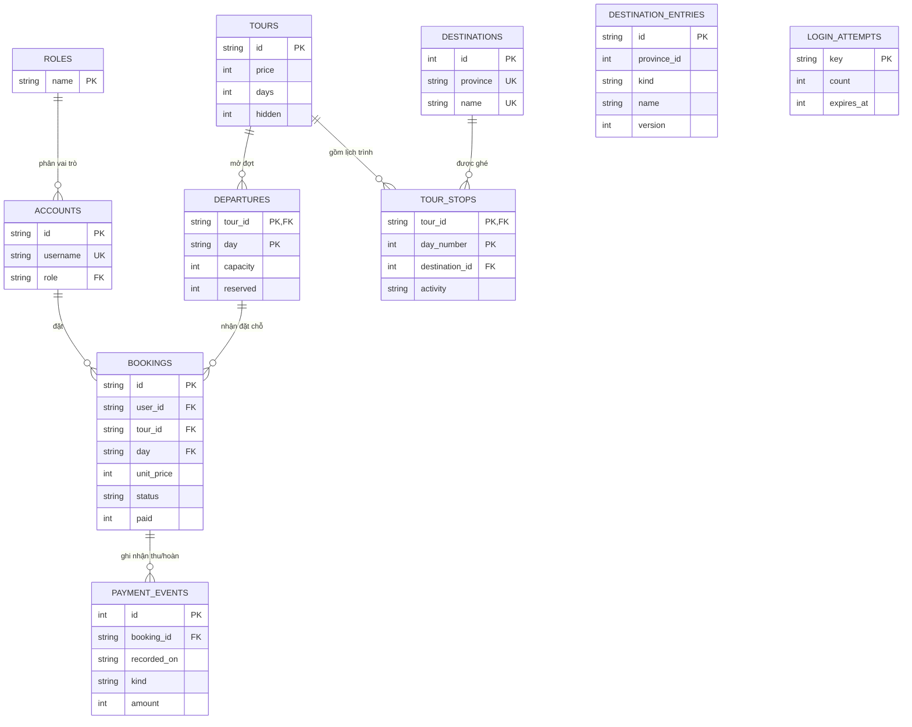
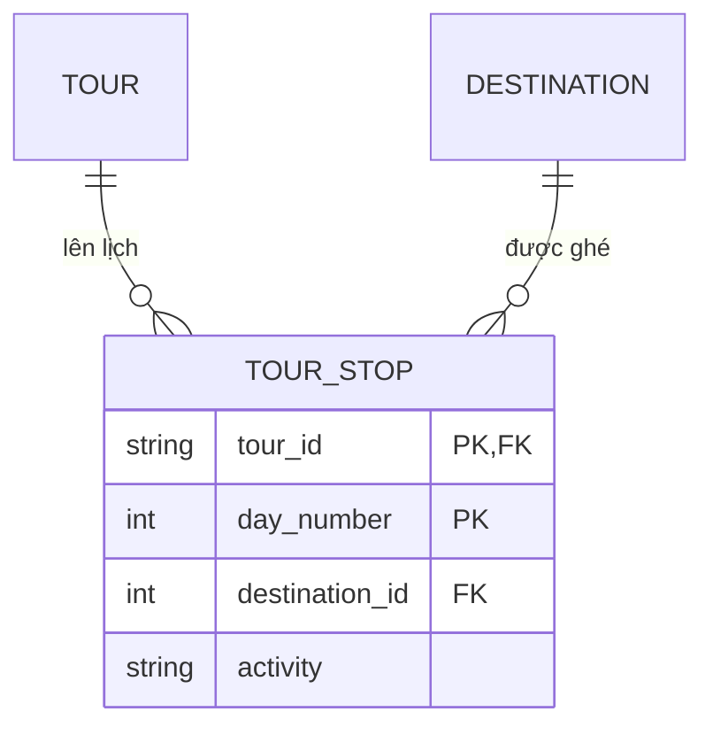
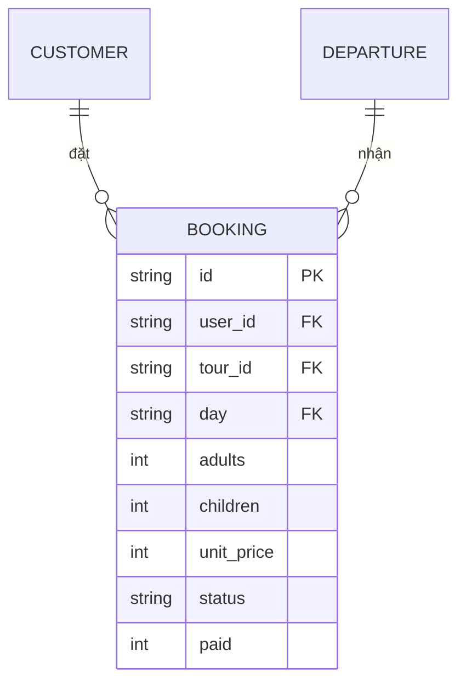

# Minh chứng 3.2 — ERD và mô hình thực thể

## Sơ đồ ERD tổng thể (10 bảng hoạt động)

## Hai liên kết nhiều–nhiều có thuộc tính

Tour có nhiều điểm ghé và một địa danh xuất hiện ở nhiều tour. `TourStop` giữ **ngày thứ mấy** và **hoạt động** riêng của mỗi liên kết. Cùng địa danh có thể xuất hiện nhiều ngày trong một tour. Khóa là `(tour_id, day_number)`; `destination_id` trỏ đến địa danh dùng chung. [Migration 0003](../Database/0003_reporting_details.sql)

Một khách có thể đặt nhiều đợt, một đợt nhận nhiều khách. `Booking` là thực thể giao dịch nối hai phía. Khóa ngoại `(tour_id, day)` trỏ đúng đợt. Mã đơn độc lập cho phép giữ nhiều lần đặt hợp lệ hoặc lịch sử các đơn đã hủy của cùng khách và đợt. [Migration 0001](../Database/0001_tour_operations.sql)

## Tám lớp có hành vi tham gia luồng chạy

| Lớp | Thực thể hoặc nguồn | Hành vi và nơi gọi |
| --- | --- | --- |
| `Tour` | `tours` | Kiểm bất biến ở cả `__post_init__` và `Tour.request()` (giá, số ngày, ảnh, `MappingProxyType`, tập `TourStop` đủ số ngày). Dùng khi `TourCatalogService.save_tour`. |
| `Destination` | `destinations` | Chuẩn hóa tên địa danh và tỉnh ở cả `__post_init__` và `Destination.request()`. `Tour` dùng khi dựng liên kết. |
| `TourStop` | `tour_stops` | Kiểm ngày thứ mấy (`1..30`), nội dung hoạt động và đối tượng `Destination` ngay trong `__post_init__`. Cung cấp `write_row()` để repository ghi trong cùng batch với tour. |
| `Departure` | `departures` | Kiểm ngày và sức chứa trước ghi. Tính chỗ còn từ sức chứa trừ chỗ đã giữ khi dựng danh mục. |
| `Booking` | `bookings` | Kiểm số khách và thông tin liên hệ, tính tổng tiền từ giá chốt, quyết định trạng thái/ngày/tiền được phép chuyển. |
| `PaymentEvent` | `payment_events` | Tính trị giá có dấu của khoản thu/hoàn. DTO khoản tiền có dấu được phiếu admin cộng thành thu ròng. |
| `CustomerAccount` | `accounts` | Kiểm dữ liệu cập nhật hồ sơ. `booking_scope()` trả ID chủ đơn để giới hạn phạm vi đọc. |
| `AdministratorAccount` | Bảng `accounts` có FK `role` tới `roles`; cấu hình chỉ khởi tạo admin lần đầu | `booking_scope()` cho phạm vi quản trị toàn bộ đơn. `public()` chỉ đưa danh tính công khai ra HTTP. |

`Account` là lớp cơ sở nội bộ cho hai loại tài khoản, không tính vào tám lớp cụ thể. Ba kiểu `StrEnum` là `Role` (admin, customer), `BookingStatus` (pending, confirmed, cancelled) và `PaymentKind` (collect, refund). Khi khởi tạo, `Booking` chuyển đổi và kiểm tra trạng thái, còn `PaymentEvent` chuyển đổi và kiểm tra loại giao dịch. Các giá trị JSON vẫn là chuỗi. Trạng thái báo cáo “quá hạn/hoàn thành” là giá trị suy ra từ ngày, trạng thái và thanh toán. [Mã miền](../backend/domain.py) · [Repository tour](../backend/repositories.py) · [Repository đơn](../backend/repositories.py)

## Đọc ngược thuộc tính lịch sử

`bookings.unit_price` được lấy từ `tours.price` (qua `PricingPolicy`) ngay trong câu lệnh tạo đơn. `Booking.total` tính `(adults + children) × unit_price` từ bản chụp trên phiếu. Ví dụ test đặt 3 người lúc giá 1.200.000 ₫, rồi sửa tour lên 5.000.000 ₫. Giá trị đơn cũ vẫn là 3.600.000 ₫. `bookings.title` cũng là bản chụp để tên hiển thị trên phiếu cũ giữ được ý nghĩa lịch sử. [Kiểm thử](../tests/test_operations.py)

Nếu đổi quan hệ Tour–Đợt từ 1–n sang n–n thì đợt có định danh riêng và cần bảng nối có khóa `(tour_id, departure_id)`. Cần quyết định chỗ giữ dùng chung cho đợt hay theo tour. Khi đó `Departure`, khóa ngoại của `Booking`, trigger giữ/trả chỗ và truy vấn sức chứa đều cần sửa theo lựa chọn đó. Trước khi đổi, phải ánh xạ các đơn lịch sử sang khóa mới để giữ chính xác ngày và tour đã đặt.
