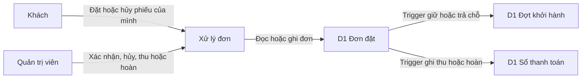

# Minh chứng 3.3 — DFD, quy tắc nghiệp vụ và phân quyền ở Service



**Đường chạy:** [Form và các nút](../dist/operations.js) → [operationsRoute](../worker/api/operations-route.js) → [BookingService](../worker/service/booking-service.js) → [lớp miền](../worker/domain) → [BookingRepository](../worker/database/booking-repository.js) → [trigger D1](../Database/0001_tour_operations.sql). Một thay đổi thanh toán ghi thêm sự kiện theo [migration 0003](../Database/0003_reporting_details.sql).

| Quy tắc và điểm thực thi | Tiền điều kiện | Hậu điều kiện |
| --- | --- | --- |
| R01 Giá chốt — `Booking.total`, `BookingRepository.placeBooking` | Tour đang mở bán, giá nguyên hợp lệ, ít nhất một người lớn | Ghi giá tại lúc đặt. Sửa giá danh mục sau đó không đổi giá trị phiếu cũ. |
| R02 Giữ chỗ đồng thời — `Booking.people`, `placeBooking`, `reserve_booking_seats` | Đợt chưa qua ngày, còn đủ chỗ cho người lớn và trẻ em | Tạo đơn chờ và tăng chỗ giữ trong cùng câu lệnh. Hai yêu cầu cuối cùng tranh chỗ thì chỉ yêu cầu hợp lệ được ghi. |
| R03 Chống trùng và giảm quá mức — `Departure`, `saveDeparture`, khóa `(tour_id, day)` | Admin; ngày hợp lệ, chưa qua; sức chứa 1–100 | Trùng ngày khi tạo trả 409. Khi chỉnh sửa, sức chứa phải ít nhất bằng số chỗ đã giữ. |
| R04 Xác nhận trước khi quá ngày — `Booking.transition('confirm')`, `updateBooking` | Admin; đơn đang chờ; ngày khởi hành lớn hơn hoặc bằng ngày hiện tại theo giờ Việt Nam | Chuyển sang xác nhận, số chỗ giữ không đổi. Quá ngày trả 409 và đơn giữ nguyên. |
| R05 Thu/hoàn theo trạng thái — `Booking.transition`, `record_payment_change` | Admin; đơn đã xác nhận. Thu khi chưa thu, hoàn khi đã thu. | Đổi cờ `paid` và thêm bút toán tương ứng trong cùng giao dịch. Lặp thao tác trả 409. |
| R06 Hủy và trả chỗ — `Booking.transition('cancel')`, `release_booking_seats` | Khách chỉ được hủy đơn chờ của chính mình. Admin hủy đơn chờ hoặc đã xác nhận khi không còn tiền đã thu. | Đơn chuyển sang hủy, trả số chỗ đúng một lần; đơn khác và lịch sử thanh toán giữ nguyên. |
| R07 Phạm vi đọc — `bookingScope`, `BookingService.bookings/paymentHistory` | Có phiên với một vai trò hợp lệ | Khách chỉ nhận DTO đơn của mình; admin đọc các đơn để xử lý. Lịch sử thu/hoàn nội bộ yêu cầu quyền admin. |

## Ma trận phân quyền

| Thao tác | Chưa đăng nhập | Khách | Quản trị viên |
| --- | --- | --- | --- |
| Xem danh mục | Tour đang bán | Tour đang bán | Mọi tour |
| Quản lý tour và đợt | Chặn | Chặn | Cho phép theo R03 |
| Đặt và xem phiếu | Chặn | Đặt và đọc phiếu của mình | Đọc phiếu để xử lý |
| Xác nhận, thu, hoàn, đọc sổ thanh toán | Chặn | Chặn | Theo R04–R05 |
| Hủy phiếu | Chặn | Phiếu chờ của mình | Phiếu chờ hoặc đã xác nhận, chưa thu hoặc đã hoàn |
| Báo cáo nội bộ | Chặn | Chặn | Cho phép |

## Thử vượt giao diện

`AccessPolicy.requireRole` kiểm danh tính do Worker đọc từ phiên. Gọi trực tiếp Service với khách để sửa tour, lập lịch, xác nhận đơn hay đọc lịch sử thu tiền đều bị từ chối với 403 trước khi chạm repository. Admin gọi hàm đặt chỗ cũng bị từ chối 403. Gọi xem đơn khi chưa có phiên trả 401. Nếu khách gửi lệnh hủy đơn chờ của người khác, câu cập nhật dùng thêm điều kiện `user_id`, nên dữ liệu không thay đổi.

```bash
node --test --test-name-pattern='Trục 3|Giữ chỗ|Phân quyền|Rollback' test/operations.test.js
npm test
```

Bộ test đi qua Service trực tiếp, Worker và SQLite tạm mô phỏng D1. Các bài kiểm thử tiêm lỗi trên DB tạm xác minh đơn, chỗ giữ và sổ tiền giữ trạng thái trước giao dịch khi thao tác lỗi.
