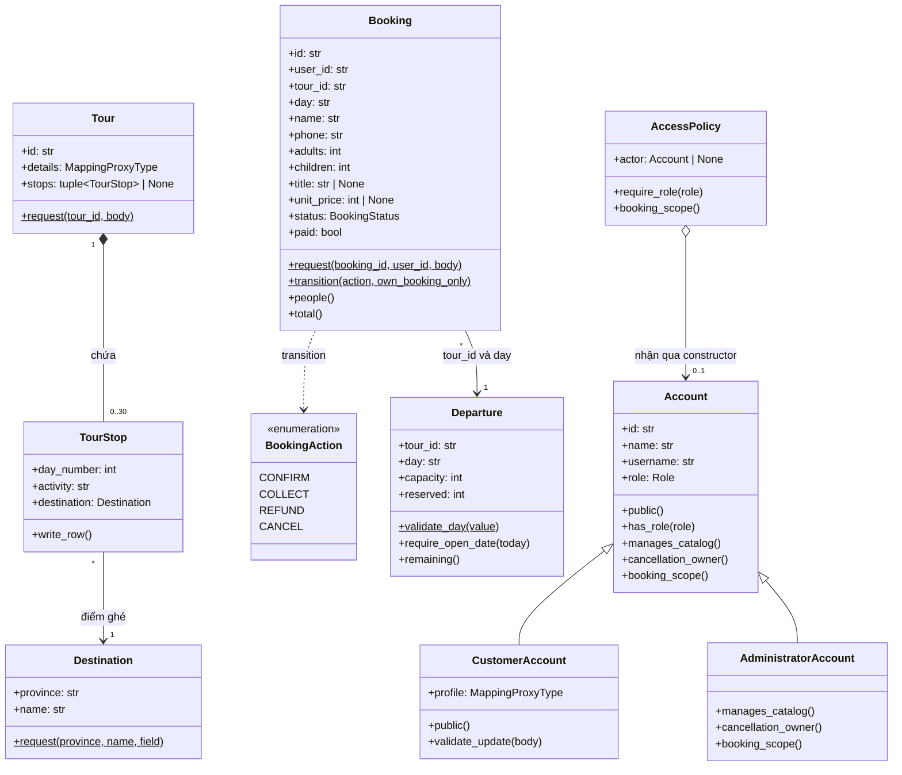
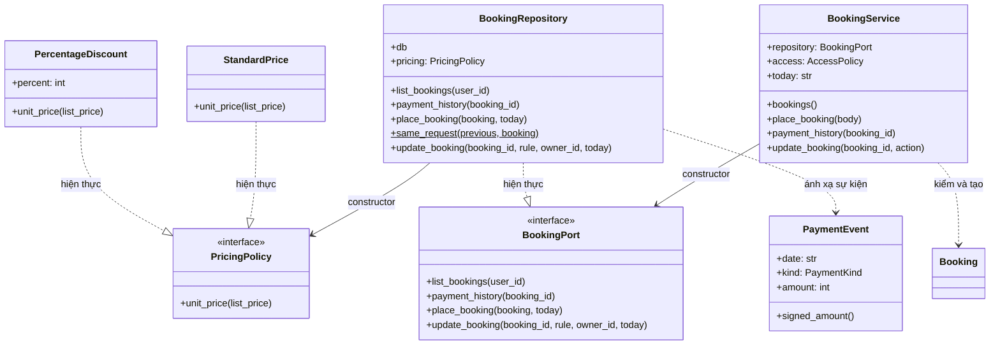

# Minh chứng 4.1 — UML lớp, vòng đời và CSDL

## Lớp miền và chính sách truy cập

`people`, `total`, `remaining`, `manages_catalog` là Python `@property`. `details` là `MappingProxyType` chỉ đọc, `stops` là `tuple`; `None` biểu thị yêu cầu sửa không gửi lịch trình. `Tour.request()` tạo và sở hữu các `TourStop`; cả `Tour`, `TourStop` và `Destination` đều kiểm tra bất biến trong `__post_init__`.

## Service, port, chính sách giá và lưu trữ

Tổng cộng sơ đồ có **14 lớp chạy thật** sau khi loại 2 interface (`BookingPort`, `PricingPolicy`). Sáu loại quan hệ và đối chiếu mã:

| Quan hệ UML | Ví dụ | Đọc từ code hoặc SQL |
| --- | --- | --- |
| Association | `Booking → Departure` | Đơn lưu `tour_id` và `day`. FK ghép trỏ đúng đợt. |
| Aggregation | `AccessPolicy ◇→ Account` | Root tạo danh tính từ phiên rồi truyền vào policy. Policy có thể bỏ đi sau request trong khi tài khoản và dữ liệu còn nguyên. |
| Composition | `Tour ◆→ TourStop` | Tour tạo riêng phần tử qua constructor, giữ mảng chỉ đọc. Điểm ghé của tour bị xóa theo tour ở DB. |
| Generalization | `CustomerAccount / AdministratorAccount → Account` | Hai lớp con dùng cú pháp kế thừa Python `class ... (Account)` và có cùng hợp đồng phạm vi đọc. |
| Realization | `BookingRepository → BookingPort` | `typing.Protocol` mô tả hợp đồng cấu trúc; lớp triển khai cung cấp đủ phương thức. Điểm lắp đặt dùng cùng hợp đồng cho adapter lưu trữ và bộ nhớ. |
| Dependency | `BookingService → Booking` | Dùng tạm `Booking.request/transition` để xử lý yêu cầu. Service không sở hữu một instance Booking dài hạn. |

Lớp cơ sở `Account` chứa constructor và mã chạy dùng chung. Hợp đồng `BookingPort` được khai báo bằng `typing.Protocol` và xác minh bằng kiểm thử.

## Kiểm toán ngược ba lớp chọn ngẫu nhiên

| Lớp | Đối chiếu cấu trúc và quan hệ |
| --- | --- |
| `Tour` | `Tour` là `@dataclass(frozen=True)`. `details` là `MappingProxyType`, `stops` là `tuple[TourStop, ...] \| None`. Cả `__post_init__` và `Tour.request()` đều bảo vệ bất biến số ngày, giá, nội dung và thứ tự các `TourStop`. [domain.py](../backend/domain.py) |
| `TourStop` | Constructor nhận `(day_number, activity, destination)` với `destination: Destination`. `__post_init__` kiểm ngày `1..30`, nội dung và kiểu `Destination`; đóng băng ba thuộc tính trong UML. `write_row()` xuất `{"dayNumber", "place", "activity"}`. [domain.py](../backend/domain.py) |
| `BookingRepository` | Constructor nhận `(db, pricing: PricingPolicy \| None = None)`, mặc định `StandardPrice()`. Bốn phương thức khớp chữ ký `BookingPort` (`list_bookings(user_id)`, `payment_history(booking_id)`, `place_booking(booking, today)`, `update_booking(booking_id, rule, owner_id, today)`) kèm `@staticmethod same_request(previous, booking)`. [repositories.py](../backend/repositories.py) |

## Bảng nghiệp vụ và phụ thuộc hàm

| Bảng | Khóa ứng viên và phụ thuộc chính | Ràng buộc |
| --- | --- | --- |
| `accounts` | `id` hoặc `username` → danh tính và hồ sơ | PK id, UNIQUE username |
| `tours` | `id` → giá, hiển thị, title, province, place, days, desc và thông tin giới thiệu | PK, CHECK giá/hiển thị/số ngày |
| `destinations` | `id` hoặc `(province,name)` xác định địa danh | PK, UNIQUE theo tỉnh/tên |
| `departures` | `(tour_id,day)` → sức chứa và chỗ giữ | PK ghép, FK tour, CHECK sức chứa và chỗ giữ |
| `tour_stops` | `(tour_id,day_number)` → điểm đến, hoạt động | PK ghép, FK tour/địa danh, CHECK ngày và hoạt động |
| `bookings` | `id` → người đặt, khóa đợt, liên hệ và giá chốt | FK khách và đợt, CHECK số người, giá, trạng thái/thu tiền |
| `payment_events` | `id` → đơn, ngày ghi, loại và số tiền | FK đơn, CHECK loại và số tiền |

Bảng `tours` lưu tên, tỉnh, điểm đến, số ngày, mô tả và giá bằng các cột riêng. Đơn lưu tên tour và giá chốt tại lúc đặt. Ràng buộc CHECK và trigger bảo vệ `reserved` và `paid`. `legacy_tour_content` là bản sao dữ liệu JSON của migration 0008, dùng để đối chiếu. [Migration](../Database)

`destination_entries`: `id` hoặc `(province_id,kind,name)` → mô tả, ảnh, nguồn, version. Đây là danh mục giới thiệu; `destinations` là điểm dùng trong lịch trình, giữ khóa và lịch sử riêng. Các kiểu miền gồm `Role`, `BookingStatus`, `BookingAction` và `PaymentKind`. Trong `Booking.transition()`, thao tác ngoài bốn giá trị của `BookingAction` gây `ValidationError`. [Mã miền](../backend/domain.py)

**Thử hủy Whole.** Migration 0005 thêm `ON DELETE CASCADE` từ tour đến phần lịch trình. Xóa tour chưa có đợt/lịch sử chỉ xóa điểm ghé của tour đó, địa danh chung và điểm ghé của tour khác vẫn còn. Xóa tour có đợt bị FK chặn. Hai ca kiểm thử xác minh hành vi trên SQLite tạm và bảo toàn dữ liệu khi nâng schema. [Migration 0005](../Database/0005_tour_stop_ownership.sql) · [Kiểm thử](../tests/test_architecture.py)
