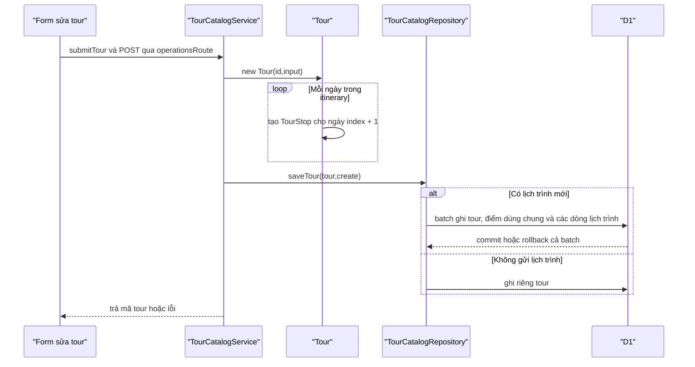
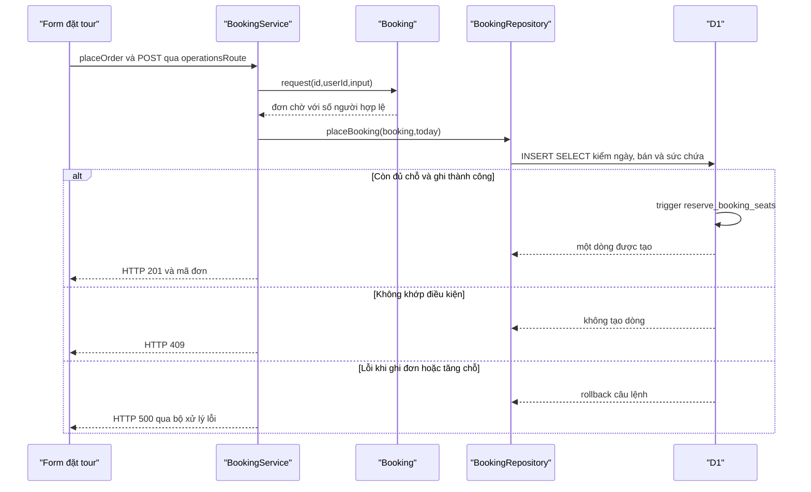
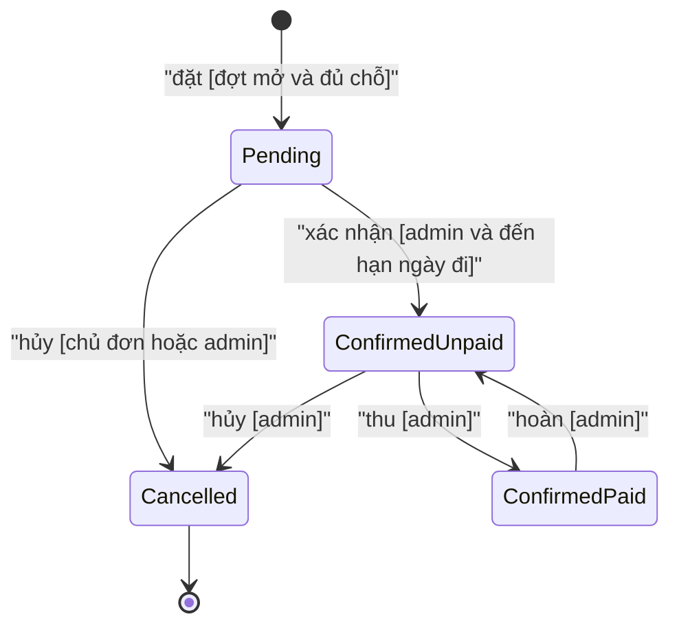

# Minh chứng 4.2 — Sequence, máy trạng thái và debugger

## Lưu tour và nhiều điểm ghé

## Đặt giữ chỗ

## Trạng thái lưu của đơn

Hai trạng thái xác nhận dùng cùng `bookings.status = confirmed` và được phân biệt bằng `paid`. Trong sơ đồ, “đến hạn ngày đi” nghĩa là ngày hiện tại ≤ ngày đi theo giờ Việt Nam. Guard nằm ở `Booking.transition()` và mệnh đề `WHERE` của `BookingRepository.updateBooking()`. Đơn chờ không thể thu tiền. Đơn đã thu phải hoàn trước khi hủy. [booking.js](../worker/domain/booking.js) · [booking-repository.js](../worker/database/booking-repository.js)

## Call Stack và Watch đã xác minh

Chạy `node scripts/debug-axis4.mjs` với Node.js 24. Script đặt breakpoint qua Node Inspector trong cùng tiến trình, gọi Worker qua HTTP Request nội bộ và xác nhận các frame/giá trị thực tại điểm dừng. [Node Inspector](https://nodejs.org/api/inspector.html)

| Breakpoint | Call Stack quan sát được | Watch |
| --- | --- | --- |
| `Tour.#buildItinerary`, dòng tạo `TourStop` | `#buildItinerary → Tour → saveTour → operationsRoute` | `index + 1` lần lượt 1 và 2 |
| `BookingService.placeBooking`, sau `Booking.request` | `placeBooking → operationsRoute` | `booking.people = 3` |
| `BookingRepository.placeBooking`, trước INSERT | `placeBooking → placeBooking → operationsRoute` | `people = 3` |
| `BookingRepository.updateBooking`, trước UPDATE khi thử thu đơn chờ | `updateBooking → updateBooking → operationsRoute` | Guard yêu cầu `confirmed`, ghi `nextPaid = true`, admin không giới hạn chủ đơn. Đơn thực tế `pending`; HTTP 409, `paid = 0`, không có bút toán. |

Khi vấn đáp, có thể mở `node --inspect-brk=127.0.0.1 scripts/demo.mjs` trong IDE, đặt breakpoint tương ứng và thao tác qua Form. Cửa sổ máy chủ sẽ hiện thông tin tài khoản thử sau khi tiếp tục chạy. Browser call stack có `placeOrder/submitTour`; Node call stack bắt đầu ở Worker vì đi qua HTTP. [Script xác minh](../scripts/debug-axis4.mjs)
