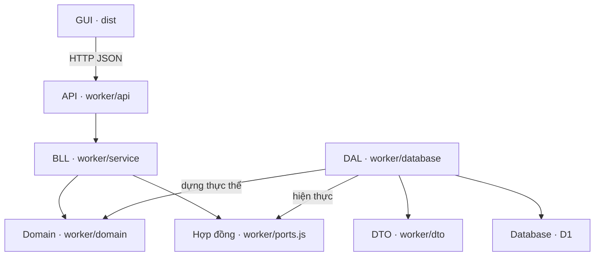

# Minh chứng 4.3 — Package, phụ thuộc và kiểm thử headless

Luồng gọi lúc chạy là GUI → API → Service → repository → DB. Chiều phụ thuộc tĩnh là Service → Domain và hợp đồng của ứng dụng; Repository hiện thực phía ngoài. `worker/index.js` là điểm lắp đặt và biết các lớp cụ thể.

| Mở file | Điều cần kiểm tra |
| --- | --- |
| [operations.js](../dist/operations.js) và [admin.js](../dist/admin.js) | Form đọc dữ liệu, kiểm nhập liệu và gọi HTTP bằng `operationsApi`. Các hàm Form không chứa SQL. |
| [operations-route.js](../worker/api/operations-route.js) | Route nhận Service đã lắp; đọc JSON, điều hướng và trả response. |
| [booking-service.js](../worker/service/booking-service.js), [tour-catalog-service.js](../worker/service/tour-catalog-service.js) và [accounts-service.js](../worker/service/accounts-service.js) | BLL dùng miền và hợp đồng port, không import lớp DAL, DOM hoặc thư viện DB. |
| [booking.js](../worker/domain/booking.js) | Domain chỉ phụ thuộc các module miền. Guard và phép tính chạy khi không có trình duyệt hoặc DB. |
| [booking-repository.js](../worker/database/booking-repository.js) và [operations.js](../worker/dto/operations.js) | Repository giữ SQL tham số hóa. DTO chuyển tên trường `day → date` và chỉ xuất các giá trị HTTP cần. |

Bài test kiến trúc đọc import tĩnh trong toàn bộ `worker/`, duyệt đồ thị để phát hiện chu kỳ, kiểm chiều phụ thuộc Domain/API/Service và dò câu lệnh SQL phổ biến trong ba tầng này. `npm test` chạy trong Node.js 24. Bài test 4.5 gọi điểm vào HTTP với dữ liệu lưu trong RAM; bài test trục 3 gọi BLL trực tiếp để kiểm chứng guard khi không có UI. [Kiểm thử](../test/architecture.test.js)

**Đánh đổi.** Nếu ghép SQL và phiên vào Form Worker, ca tạo đơn `BookingService.placeBooking` sẽ cần môi trường DB hoặc UI để kiểm thử. Chia lớp tăng số điểm phải mở khi đọc một yêu cầu và đòi hỏi kiểm tra DTO cùng hợp đồng. Với truy vấn chỉ dùng một lần ở script độc lập, chi phí chia tầng có thể lớn hơn lợi ích tái sử dụng.
